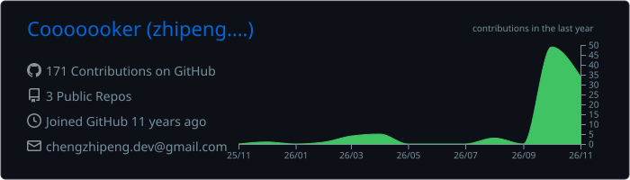
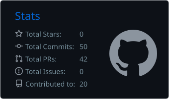
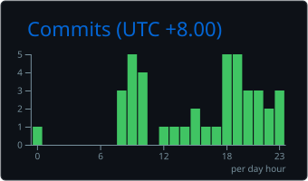

### Hi, I'm Zhipeng 👋

Engineer in Chengdu. Started on iOS, moved to Go backends, now building native UI in Rust, with AI agents in the loop every day.

```rust
struct Engineer {
    name:     &'static str,
    location: &'static str,
    path:     [&'static str; 3],
    now:      &'static [&'static str],
    motto:    &'static str,
}

const ME: Engineer = Engineer {
    name:     "Zhipeng Cheng",
    location: "Chengdu, China",
    path:     ["iOS (Objective-C / Swift)", "Backend (Go)", "Native UI runtime (Rust)"],
    now:      &["Native Shell: TSX → native views on 7 platforms", "Aloud Ink: AI voice input"],
    motto:    "Investigate things, extend knowledge.",
};
```

### 🛠️ Tech Stack

<p>
  
  
  
  
  
  
  <br/>
  
  
  
  
  
</p>

### 🔭 What I'm working on

<table>
<tr>
<td width="50%" valign="top">

#### 🧩 [Native Shell (NSH)](https://github.com/longbridge/nsh)
<sub>TSX modules rendered with each platform's own UI: iOS, Android, macOS, Windows, Linux, GPUI and the web.</sub>


- ✏️ `RichEditor`: IME composition, touch selection, undo grouping
- 😀 `EmojiPicker`: search over every emoji, virtualized grid
- 🌐 Web runtime: text measuring, clipboard images, input methods
- 📱 iOS / Android: keyboard, modals, swipe-back, touch responders

</td>
<td width="50%" valign="top">

#### 🎙️ [Aloud Ink](https://aloud.ink): 说出来，就成文
<sub>AI voice input: press a key, speak, and clean text lands at your cursor. Co-built with [@griffinqiu](https://github.com/griffinqiu).</sub>


- 🖥️ macOS client in Rust + GPUI: global hotkey, HUD that keeps focus
- ⚡ Audio streamed over WebSocket to a Go server
- 🧠 ASR, then an LLM strips filler words; text typed back at the cursor
- 📱 iOS keyboard extension on the same protocol

</td>
</tr>
</table>

#### More from [Longbridge open source](https://github.com/longbridge)

| Project | |
|---|---|
| [longbridge-terminal](https://github.com/longbridge/longbridge-terminal)  | AI-native CLI for the Longbridge trading platform (Rust) |
| [openapi](https://github.com/longbridge/openapi)  · [openapi-go](https://github.com/longbridge/openapi-go) | Longbridge OpenAPI SDKs (Rust core, Go) |
| [developers](https://github.com/longbridge/developers) | Longbridge developer docs site (TypeScript) |
| [nsh-compat](https://github.com/longbridge/nsh-compat) | The API NSH releases froze, and the checks that hold NSH to it |

### 📊 GitHub Stats

<div align="center">
  
  
  
  
</div>

<picture>
  <source media="(prefers-color-scheme: dark)" srcset="https://raw.githubusercontent.com/Cooooooker/Cooooooker/output/snake-dark.svg" />
  
</picture>
